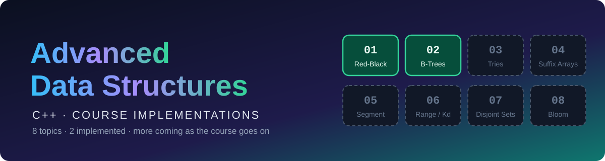
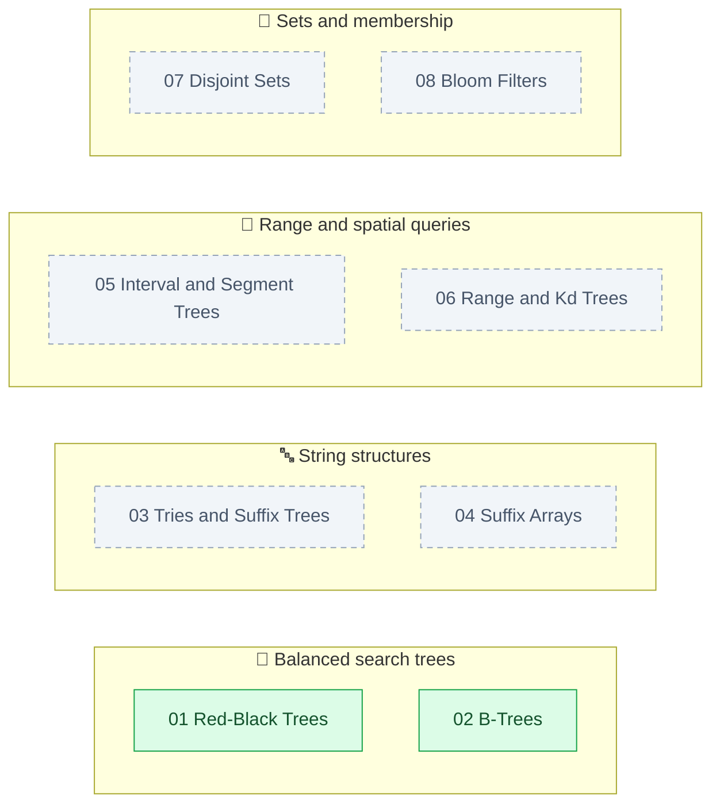
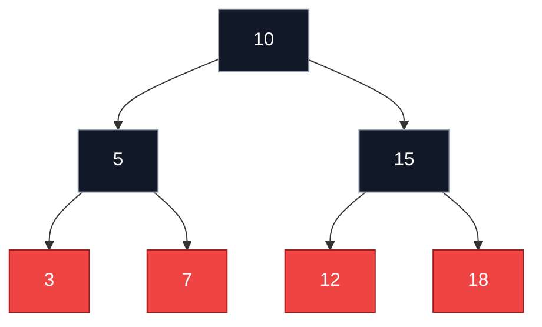
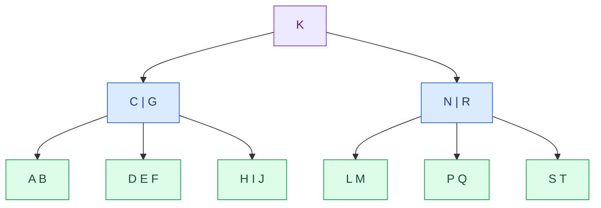

<div align="center">



<br/>


**C++ implementations and notes for the Advanced Data Structures course. One folder per topic, each with source code, examples and its own documentation.**

[Topics](#-course-topics) · [Structure](#-repository-structure) · [Quick start](#-quick-start) · [Red-Black Trees](#-1-red-black-trees) · [B-Trees](#-2-b-trees) · [Comparison](#-red-black-tree-vs-b-tree) · [Roadmap](#-roadmap) · [Author](#-author)

</div>

---

## 📚 Course Topics

```text
Progress   █████████░░░░░░░░░░░░░░░░░░░░░░░░░░░   2 / 8   (25%)
```

| # | Topic | Folder | Status | Docs |
|:---:|---|---|:---:|:---:|
| 1 | 🔴⚫ [Red-Black Trees](#-1-red-black-trees) | `01-red-black-trees/` | ✅ Implemented | [README](01-red-black-trees/README.md) |
| 2 | 🌳 [B-Trees](#-2-b-trees) | `02-b-trees/` | ✅ Implemented | [README](02-b-trees/README.md) |
| 3 | 🔤 [Tries and Suffix Trees](#-3-tries-and-suffix-trees) | `03-tries-and-suffix-trees/` | 🕒 Coming soon | |
| 4 | 🧵 [Suffix Arrays](#-4-suffix-arrays) | `04-suffix-arrays/` | 🕒 Coming soon | |
| 5 | 📏 [Interval and Segment Trees](#-5-interval-and-segment-trees) | `05-interval-and-segment-trees/` | 🕒 Coming soon | |
| 6 | 🧭 [Range and Kd Trees](#-6-range-and-kd-trees) | `06-range-and-kd-trees/` | 🕒 Coming soon | |
| 7 | 🔗 [Disjoint Sets](#-7-disjoint-sets) | `07-disjoint-sets/` | 🕒 Coming soon | |
| 8 | 🌸 [Bloom Filters](#-8-bloom-filters) | `08-bloom-filters/` | 🕒 Coming soon | |

### 🗺️ The big picture



---

## 🗂️ Repository Structure

```text
Advanced-Data-Structures/
├── README.md
├── assets/
│   ├── banner_root.svg
│   └── team.svg
├── 01-red-black-trees/
│   ├── Red_Black_Tree.h
│   ├── main.cpp
│   └── README.md
├── 02-b-trees/
│   ├── B_Tree.h
│   ├── B_Tree.cpp
│   └── README.md
├── 03-tries-and-suffix-trees/
├── 04-suffix-arrays/
├── 05-interval-and-segment-trees/
├── 06-range-and-kd-trees/
├── 07-disjoint-sets/
└── 08-bloom-filters/
```

> [!NOTE]
> Each topic folder is **self-contained**. Build and run it from inside its own folder.

---

## 🚀 Quick start

**Requirements:** a C++11 (or newer) compiler such as `g++`, `clang++` or MSVC.

```bash
git clone https://github.com/<your-username>/Advanced-Data-Structures.git
cd Advanced-Data-Structures
```

| Topic | Build and run |
|---|---|
| 🔴⚫ Red-Black Trees | `cd 01-red-black-trees` then `g++ -std=c++11 main.cpp -o rbtree` then `./rbtree` |
| 🌳 B-Trees | `cd 02-b-trees` then `g++ -std=c++11 B_Tree.cpp -o B_Tree` then `./B_Tree` |

On Windows, run the program with `.\rbtree.exe` or `.\B_Tree.exe`.

---

## 🔴⚫ 1. Red-Black Trees

📁 [`01-red-black-trees/`](01-red-black-trees/) · 📖 [Full documentation](01-red-black-trees/README.md)

A header-only implementation of a **Red-Black Tree**, a self-balancing binary search tree. Search, insertion and deletion all run in **O(log n)**. The project includes an interactive menu to build and explore the tree.

**Status:** ✅ Implemented

### ✨ Features

| | |
|---|---|
| ➕ **Insert** | Automatic rebalancing with recoloring and rotations |
| ➖ **Delete** | Remove a value by key, using the in-order successor |
| 🔎 **Search** | Reports the node's color, its parent, and its position |
| 🎨 **Print** | A sideways diagram with the color of every node |
| 🕹️ **Interactive menu** | A `switch` menu with safe input handling |

### 🧠 How it works

Every node is either red or black, and the tree keeps these rules:

1. The root is black.
2. A red node never has a red child.
3. Every path from a node down to its empty children has the same number of black nodes.

When an insert or delete breaks a rule, the tree repairs itself with recoloring and rotations (`fixInsert`, `fixDelete`, `leftRotate`, `rightRotate`).



### 💻 Usage

```cpp
#include "Red_Black_Tree.h"

int main() {
    RedBlackTree tree;

    tree.insert(10);
    tree.insert(5);
    tree.insert(15);

    tree.printTree();
    tree.searchAndPrint(15);   // 15 found. Color: BLACK, parent = 10 (right child)
    tree.remove(5);
}
```

<details>
<summary><b>📚 API and complexity</b></summary>

<br/>

| Method | Returns | Description |
|---|:---:|---|
| `insert(int val)` | `void` | Inserts `val` and rebalances. Duplicates go right |
| `remove(int val)` | `void` | Deletes the first node matching `val` |
| `search(int val) const` | `bool` | `true` if `val` exists. Prints nothing |
| `searchAndPrint(int val) const` | `void` | Prints whether `val` was found, with its color and parent |
| `printTree()` | `void` | Prints the tree sideways (root on the left) |

| Operation | Time |
|---|:---:|
| Insert | O(log n) |
| Delete | O(log n) |
| Search | O(log n) |
| Print | O(n) |

</details>

<details>
<summary><b>⚠️ Known limitations</b></summary>

<br/>

- **Delete rebalancing gap:** `fixDelete` is only called when the replacement node is not `nullptr`, so deleting a black node with no children can leave the tree unbalanced.
- **No destructor:** nodes are not freed when the tree goes out of scope.
- **Copying** is not disabled.
- Keys are `int` only.

</details>

<details>
<summary><b>🛣️ Planned improvements</b></summary>

<br/>

- [ ] Fix black-leaf deletion in `fixDelete`
- [ ] Add a destructor and disable copying
- [ ] Add an `isValid()` checker
- [ ] Add tree traversals (in-order, pre-order, post-order, level-order)
- [ ] Convert to a template (`RedBlackTree<T>`)

</details>

---

## 🌳 2. B-Trees

📁 [`02-b-trees/`](02-b-trees/) · 📖 [Full documentation](02-b-trees/README.md)

A generic **B-Tree of any order**, built with inheritance: `Node`, `InternalNode` and `LeafNode`. Leaves hold keys only, and internal nodes also hold children. Insert and delete run in **O(log n)**.

**Status:** ✅ Implemented

### ✨ Features

| | |
|---|---|
| 🌳 **Any order** | The order is a template parameter: `BTree<int, 3>`, `BTree<char, 5>` |
| 🧬 **Inheritance design** | No wasted child pointers in leaves |
| ➕ **Insert** | Insert first, split on overflow, and the split propagates up to the root |
| ➖ **Delete** | Predecessor replacement, borrowing, merging, and shrinking the root |
| 🖨️ **Print** | Prints the tree with indentation, one node per line |
| ✅ **Tested** | Checked against `std::set` on thousands of random operations, with AddressSanitizer |

### 🧠 How it works

`Ord` is the **maximum number of children** of a node. Every non-root node keeps at least `(Ord - 1) / 2` keys. A node that reaches `Ord` keys is **split**, and a node that drops below the minimum **borrows** from a sibling or **merges** with it.



### 💻 Usage

```cpp
#include "B_Tree.h"

int main() {
    BTree<int, 3> t;
    int a[] = {1, 5, 0, 4, 3, 2};
    for (int x : a) t.Insert(x);
    t.Print();

    t.Delete(4);
    t.Print();
}
```

```text
1,4
  0
  2,3
  5

1,3
  0
  2
  5
```

<details>
<summary><b>📚 API and complexity</b></summary>

<br/>

| Member | Description |
|---|---|
| `BTree<Type, Ord> t;` | Creates an empty tree |
| `void Insert(Type value)` | Inserts a value |
| `bool Delete(Type value)` | Deletes a value. Returns `true` if it was found |
| `void Print() const` | Prints the tree, one node per line |
| `int getHeight() const` | Number of levels. Don't call it on an empty tree |

| Operation | Time |
|---|:---:|
| Insert | O(log n) |
| Delete | O(log n) |
| Print | O(n) |

</details>

<details>
<summary><b>⚠️ Known limitations</b></summary>

<br/>

- **Duplicates are not handled.** `Insert` does not reject them, and `Delete` removes one occurrence.
- There is **no `Search`** function yet.
- `Ord` must be **3 or more**.
- `getHeight()` assumes a non-empty tree.

</details>

---

## ⚖️ Red-Black Tree vs B-Tree

Both keep the tree balanced and both are `O(log n)`, but they balance in different ways.

| | 🔴⚫ Red-Black Tree | 🌳 B-Tree |
|---|---|---|
| **Keys per node** | 1 | Up to `Ord - 1` |
| **Children per node** | 2 | Up to `Ord` |
| **Stays balanced by** | Recoloring and rotations | Splitting, borrowing and merging |
| **How the tree grows** | At the leaves | Only at the root |
| **Height** | Taller | Shorter, because nodes are wide |
| **Good fit** | In-memory ordered containers | Disk and database indexes, where fewer node reads matter |

---

## 🔜 Upcoming topics

### 🔤 3. Tries and Suffix Trees

**Status:** 🕒 Coming soon

### 🧵 4. Suffix Arrays

**Status:** 🕒 Coming soon

### 📏 5. Interval and Segment Trees

**Status:** 🕒 Coming soon

### 🧭 6. Range and Kd Trees

**Status:** 🕒 Coming soon

### 🔗 7. Disjoint Sets

**Status:** 🕒 Coming soon

### 🌸 8. Bloom Filters

**Status:** 🕒 Coming soon

> Each topic will get a description, features, build instructions and an API table here when it is finished.

---

## 🛣️ Roadmap

- [x] 01 Red-Black Trees
- [x] 02 B-Trees
- [ ] 03 Tries and Suffix Trees
- [ ] 04 Suffix Arrays
- [ ] 05 Interval and Segment Trees
- [ ] 06 Range and Kd Trees
- [ ] 07 Disjoint Sets
- [ ] 08 Bloom Filters

---

## ➕ Adding a New Topic

When you finish a topic:

1. Create its folder (`0N-topic-name/`) with the source code and a `README.md`.
2. Change its status in the table at the top to ✅ Implemented and add the link to its docs.
3. Tick it in the roadmap, and update the progress badge and the progress bar.
4. Replace its "Coming soon" section with the template below.

````markdown
## 🔹 N. Topic Name

📁 [`0N-topic-name/`](0N-topic-name/) · 📖 [Full documentation](0N-topic-name/README.md)

Short description of the data structure and why it is useful.

**Status:** ✅ Implemented

### ✨ Features
- ...

### 💻 Usage
```cpp
// short example
```

<details>
<summary><b>📚 API and complexity</b></summary>

| Method | Returns | Description |
|---|---|---|
| ... | ... | ... |

| Operation | Time |
|---|---|
| ... | ... |

</details>

<details>
<summary><b>⚠️ Known limitations</b></summary>

- ...

</details>
````

---

## 👤 Author

<div align="center">


<br/>

<sub><i>Learning data structures by building them, one at a time.</i></sub>

</div>
