<div align="center">


<br/>


**A header-only Red-Black Tree with an interactive menu to build, search, delete and visualize the tree.**

[Features](#-features) · [How it works](#-how-a-red-black-tree-works) · [Insertion](#-how-insertion-works) · [Deletion](#-how-deletion-works) · [Usage](#-getting-started) · [API](#-api-reference) · [Limitations](#-known-limitations) · [Roadmap](#-roadmap) · [Author](#-author)

</div>

---

## ✨ Features

| | |
|---|---|
| ➕ **Insert** | Automatic rebalancing with recoloring and rotations |
| ➖ **Delete** | Remove a value by key, using the in-order successor |
| 🔎 **Search** | Reports the node's color, its parent, and whether it is a left or right child |
| 🎨 **Visualize** | Prints the tree sideways, with the color of every node |
| 🕹️ **Interactive menu** | A `switch`-driven menu to build and explore the tree |
| 🛡️ **Safe input** | Typing letters instead of numbers does not break the program |
| 📦 **Header-only** | Just include one file |

---

## 🌳 How a Red-Black Tree Works

Every node is either 🔴 **red** or ⚫ **black**, and the tree always keeps these rules:

| # | Rule |
|:---:|---|
| 1 | The **root is black** |
| 2 | A **red node never has a red child** (no two reds in a row) |
| 3 | Every path from a node down to its empty children has the **same number of black nodes** |

Empty children (`nullptr`) count as black.

These rules guarantee that the longest path is never more than **twice** the shortest path, so the height stays **O(log n)**.

When an insert or a delete breaks a rule, the tree repairs itself:

| Operation | Repair function | Tools used |
|---|---|---|
| Insert | `fixInsert` | Recoloring, left and right rotations |
| Delete | `fixDelete` | Recoloring, left and right rotations |

### 🔄 Rotations

A rotation changes the shape of a small part of the tree in **O(1)** and keeps the in-order ordering.

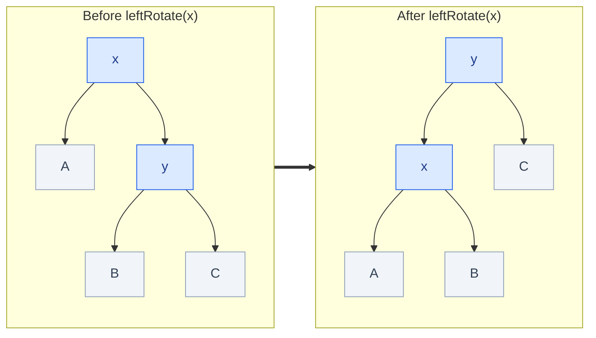

`rightRotate` is the mirror image.

---

## ➕ How insertion works

A new node is always inserted **red**, like in a normal BST. Then `fixInsert` repairs any problem.

The only rule that can break is rule 2 (a red parent with a red child). What to do depends on the **uncle**, the sibling of the parent. An empty uncle counts as black.

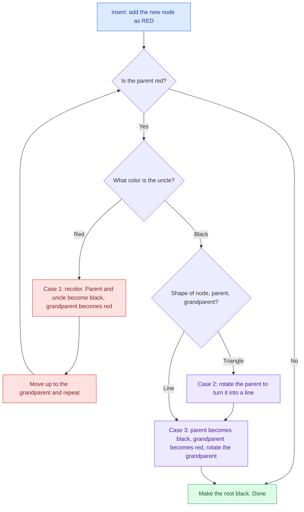

| Case | Uncle | Shape | Fix |
|:---:|:---:|:---:|---|
| **1** | 🔴 Red | any | Recolor, then continue from the grandparent |
| **2** | ⚫ Black | Triangle (`<` or `>`) | Rotate the parent, which gives case 3 |
| **3** | ⚫ Black | Line (`/` or `\`) | Recolor and rotate the grandparent. Finished |

> [!NOTE]
> Recoloring can push the problem up the tree. Rotations always finish the repair. So an insert needs **at most 2 rotations**.

### 🎬 Simulation A: recoloring (case 1)

Inserting `10, 5, 15, 3, 7, 12, 18`.

**① Insert `10`**: it is the root, so it becomes black.

**② Insert `5`**: red, as the left child of `10`. Its parent is black, so nothing to fix.

**③ Insert `15`**: red, as the right child of `10`. Its parent is black, nothing to fix.

**④ Insert `3`**: red, under `5`. Now a **red parent has a red child**. 🔥

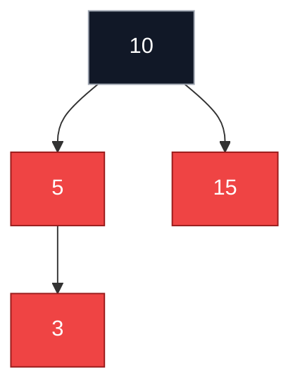

The uncle `15` is **red**, so this is **case 1: recolor**. `5` and `15` become black, `10` becomes red, and then the root is turned black again.

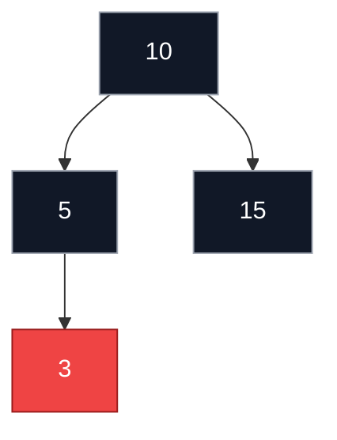

**⑤ Insert `7`**: red, under black `5`. Nothing to fix.

**⑥ Insert `12`**: red, under black `15`. Nothing to fix.

**⑦ Insert `18`**: red, under black `15`. Nothing to fix.

Final tree (no rotation was needed):

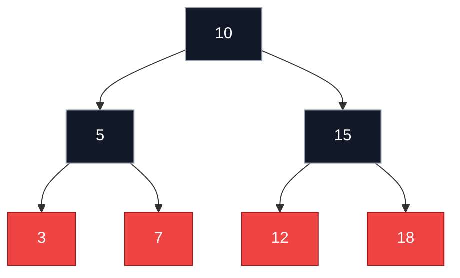

### 🎬 Simulation B: a line, one rotation (case 3)

Inserting `1, 2, 3`.

After `1` (black root) and `2` (red right child), insert `3` as the red right child of `2`. This is a **line** to the right, and the uncle is empty (black). 🔥

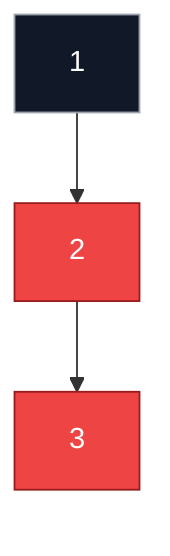

Fix: `2` becomes black, `1` becomes red, and a **left rotation** on `1`.

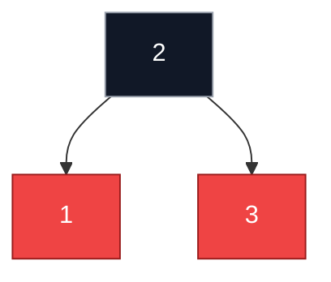

### 🎬 Simulation C: a triangle, two rotations (case 2 then 3)

Inserting `3, 1, 2`.

`3` is the black root, `1` is its red left child, and `2` goes as the red **right** child of `1`. The path `3 → 1 → 2` bends, so it is a **triangle**. 🔥

1. **Left rotation on `1`** turns it into a line: `3 → 2 → 1`.
2. Then case 3: recolor and **right rotation on `3`**.

The result is the same balanced tree as in simulation B: `2` black in the middle, with `1` and `3` red.

### 🎬 Simulation D: ascending input `1..7`

A normal BST would become a chain of 7 nodes. The Red-Black Tree stays balanced:

| Insert | What happened | Tree (`value` + color, children in brackets) |
|:---:|---|---|
| `1` | Becomes the black root | `1⚫` |
| `2` | Red child, black parent | `1⚫(-, 2🔴)` |
| `3` | Line, black uncle: **rotate left** | `2⚫(1🔴, 3🔴)` |
| `4` | Red uncle: **recolor** | `2⚫(1⚫, 3⚫(-, 4🔴))` |
| `5` | Line, black uncle: **rotate left** | `2⚫(1⚫, 4⚫(3🔴, 5🔴))` |
| `6` | Red uncle: **recolor** (`4` turns red) | `2⚫(1⚫, 4🔴(3⚫, 5⚫(-, 6🔴)))` |
| `7` | Line, black uncle: **rotate left** | `2⚫(1⚫, 4🔴(3⚫, 6⚫(5🔴, 7🔴)))` |

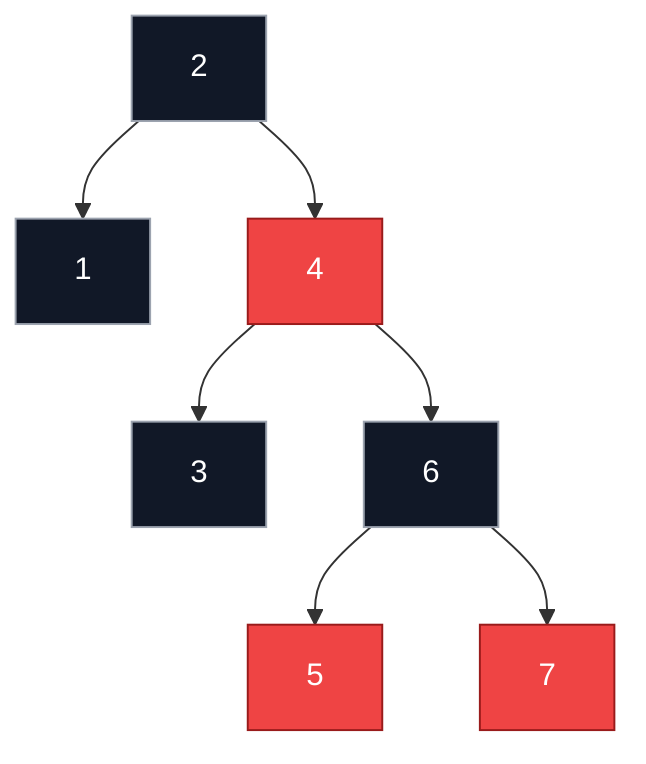

The height is 4 instead of 7. Check rule 3: every path from the root down to an empty child crosses exactly **2 black nodes**.

---

## ➖ How deletion works

Deletion is harder than insertion. Removing a **red** node never breaks a rule. Removing a **black** node can break rule 3, so the tree has to be repaired.

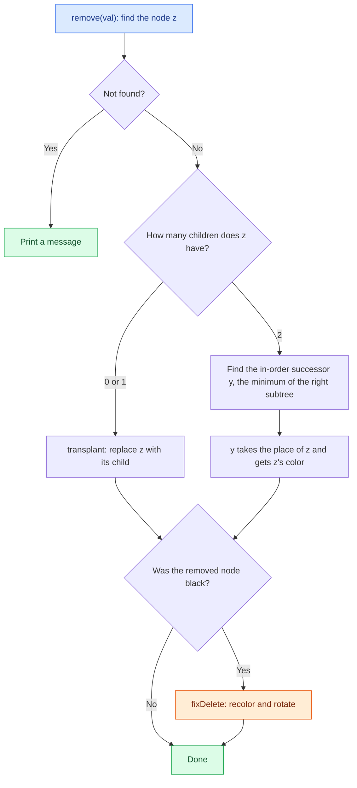

### 🛠️ The four repair cases (`fixDelete`)

Here `x` is the node that carries an "extra black", and `w` is its sibling.

| Case | Sibling `w` | Fix |
|:---:|---|---|
| **1** | 🔴 Red | Recolor `w` and the parent, rotate the parent. Now `w` is black, so go to case 2, 3 or 4 |
| **2** | ⚫ Black, both its children black | Make `w` red and move the extra black up to the parent |
| **3** | ⚫ Black, far child black, near child red | Rotate `w` and recolor. This gives case 4 |
| **4** | ⚫ Black, far child red | Recolor and rotate the parent. Finished |

The same four cases are mirrored when `x` is a right child.

### 🎬 Simulation: `remove(5)`

Start with the final tree from simulation A. Node `5` is black and has **two children** (`3` and `7`).

1. The in-order successor is the minimum of the right subtree: `7`.
2. `7` is **red**, so removing it from its old place does not break rule 3. No `fixDelete` is needed.
3. `7` takes the place of `5` and **gets `5`'s color (black)**.

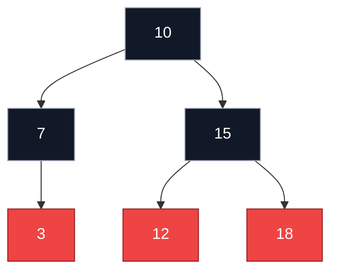

Every path from the root still crosses 2 black nodes, so the tree is valid.

---

## 📁 Project Structure

```
Red-Black-tree/
├── Red_Black_Tree.h   # Node and RedBlackTree classes (header-only)
├── main.cpp           # Interactive menu program
├── assets/
│   └── banner_rbtree.svg
└── README.md
```

---

## 🚀 Getting Started

### Requirements

A C++11 (or newer) compiler, such as `g++`, `clang++` or MSVC.

### Build and run

```bash
g++ -std=c++11 main.cpp -o rbtree
./rbtree
```

On Windows:

```bash
g++ -std=c++11 main.cpp -o rbtree.exe
rbtree.exe
```

Or open the folder in Xcode, Visual Studio or CLion and run `main.cpp`.

---

## 🕹️ Interactive Menu

```text
===== Red-Black Tree Menu =====
1. Insert a value
2. Delete a value
3. Search for a value
4. Print the tree
0. Exit
Choose an option:
```

| Option | Action |
|:---:|---|
| `1` | Insert an integer into the tree |
| `2` | Delete an integer from the tree (prints a message if not found) |
| `3` | Search for an integer and show its color and parent |
| `4` | Print the current tree structure |
| `0` | Exit the program |

### Sample session

```text
Choose an option: 1
Enter value to insert: 10
10 inserted.

Choose an option: 3
Enter value to search: 10
10 found. Color: BLACK, it is the root.

Choose an option: 3
Enter value to search: 99
99 not found.
```

---

## 🐍 Using the Class in Your Own Code

```cpp
#include <iostream>
#include "Red_Black_Tree.h"

int main() {
    RedBlackTree tree;

    tree.insert(10);
    tree.insert(5);
    tree.insert(15);
    tree.insert(3);
    tree.insert(7);
    tree.insert(12);
    tree.insert(18);

    tree.printTree();

    if (tree.search(12))
        std::cout << "12 exists in the tree\n";

    tree.searchAndPrint(12);   // 12 found. Color: RED, parent = 15 (left child)

    tree.remove(5);
    tree.printTree();

    return 0;
}
```

---

## 📚 API Reference

All public methods belong to the `RedBlackTree` class.

| Method | Returns | Description |
|---|:---:|---|
| `insert(int val)` | `void` | Inserts `val` and rebalances the tree. Duplicates go to the right subtree |
| `remove(int val)` | `void` | Deletes the first node matching `val`. Prints a message if it is not found |
| `search(int val) const` | `bool` | Returns `true` if `val` exists. Prints nothing |
| `searchAndPrint(int val) const` | `void` | Prints whether `val` was found, with its color and parent |
| `printTree()` | `void` | Prints the tree sideways (right subtree on top, root at the left) |

> [!NOTE]
> `search` only returns a result. To see output on screen, use its return value in an `if` statement, or call `searchAndPrint`.

### 📊 Complexity

| Operation | Time |
|---|:---:|
| Insert | O(log n) |
| Delete | O(log n) |
| Search | O(log n) |
| Print | O(n) |

Space used by the tree is O(n).

---

## 🖨️ Example Output

Building a tree from `10, 5, 15, 3, 7, 12, 18` and calling `printTree()`:

```text
          18(RED)

     15(BLACK)

          12(RED)

10(BLACK)

          7(RED)

     5(BLACK)

          3(RED)
```

The diagram is rotated 90 degrees: the **root is on the left**, each level is indented further to the right, **right children appear above** their parent, and **left children appear below**.

After `remove(5)`:

```text
          18(RED)

     15(BLACK)

          12(RED)

10(BLACK)

     7(BLACK)

          3(RED)
```

---

## 🧩 Implementation Notes

- **Node** stores `data`, `color`, and pointers to `left`, `right` and `parent`. Its constructor is private, and `RedBlackTree` is declared a `friend`, so only the tree can create nodes.
- New nodes are always inserted **red**, then `fixInsert` repairs any violation.
- **Rotations** (`leftRotate`, `rightRotate`) run in O(1) and preserve the in-order ordering.
- **Deletion** uses the `transplant` helper and replaces a node with two children by its in-order successor (the minimum of the right subtree).
- Empty children (`nullptr`) are treated as black.

---

## ⚠️ Known Limitations

This project is meant for learning and experimentation. Before using it in production, be aware of the following:

- **Delete rebalancing gap:** `deleteNode` only calls `fixDelete` when the replacement node `x` is not `nullptr`. Deleting a **black node that has no children** skips the repair step and can leave the tree violating the black-height rule. The fix is to pass the parent of `x` into `fixDelete` and treat `nullptr` as black.
- **No destructor:** nodes are not freed when the tree goes out of scope, which causes a memory leak at program exit. Add a `~RedBlackTree()` that deletes all nodes recursively.
- **Copying:** copy construction and assignment are not disabled, so copying a tree would share nodes. Mark them `= delete` or implement a deep copy.
- **Integers only:** keys are `int`. Making the classes templates would support other types.
- **Duplicates:** equal values are allowed and go to the right, and `remove` deletes only the first match found.
- **One print style:** only the sideways view exists. A level-by-level view is not implemented.

---

## 🗺️ Roadmap

- [ ] Fix `fixDelete` for black leaf deletion
- [ ] Add a destructor and disable copying
- [ ] Add an `isValid()` function to verify the Red-Black properties
- [ ] Add in-order, pre-order, post-order and level-order traversals
- [ ] Convert to a template (`RedBlackTree<T>`)
- [ ] Add unit tests

---

## 👤 Author

<div align="center">

**Kareem Ahmed**

<br/>

Made with 🔴 ⚫ and a lot of rotations

</div>
